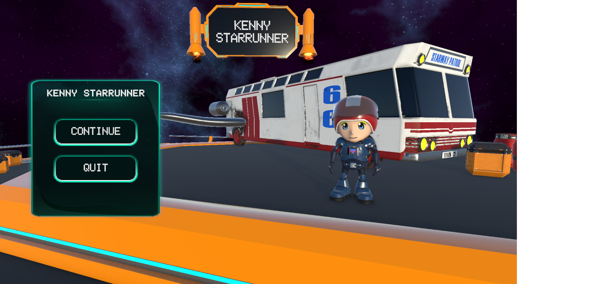
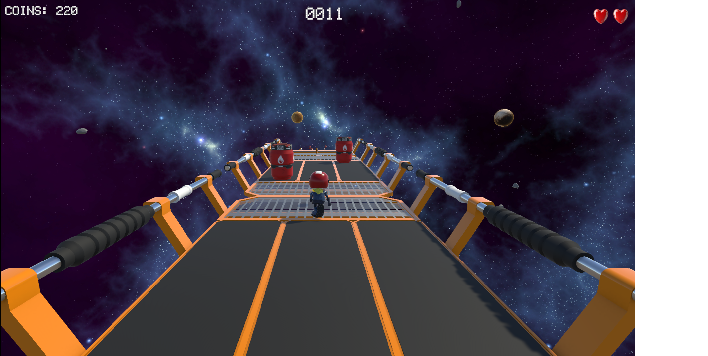

# Kenny StarRunner

**Kenny StarRunner** is a 3D sci-fi endless runner made in Unity as a collaborative
school project. The player runs through space-themed obstacle courses, collects
coins, avoids hazards, and uses the in-game store to unlock and equip upgrades.

## Highlights

- Space-themed 3D runner gameplay
- Procedurally varied obstacle sections
- Collectible coins and a store/equipment system
- Health, damage, and pickup feedback
- Custom menus, title effects, and player cosmetics
- Consistent 1920x1080 build presentation

## My contributions

I contributed gameplay programming, systems integration, debugging, and
polishing across the project. Selected contributions include:

- Implemented and fixed store purchasing and item re-equipping behavior.
- Added coin spawning and visual growth behavior across level prefabs.
- Reworked the health display from a health bar to a heart-based UI.
- Added title and equipment methods to the game manager.
- Improved runner movement, obstacle spawning, camera behavior, and sliding on
  rails.
- Added and polished environmental details such as bus lights and level
  obstacles.
- Configured the build to run consistently at 1920x1080.

The repository history contains the complete team development history. This
was a shared school project, not a solo project; the contribution list above
describes my work specifically.

## Technology

- Unity
- C#
- Unity Input System
- TextMesh Pro

## Project structure

The Unity project is located in [`Kenny StarRunner/`](Kenny%20StarRunner/).
Gameplay scripts and systems are under
[`Kenny StarRunner/Assets/Scripts/`](Kenny%20StarRunner/Assets/Scripts/).

## Team and attribution

This project was created collaboratively by the student team. It is presented
here with the team's agreement so individual contributions can be shown
professionally.

The original team repository is available at
[Jimbo420/GSUU-VT25-Grupp-05-3D](https://github.com/Jimbo420/GSUU-VT25-Grupp-05-3D).
Please see [`LICENSE`](LICENSE) for the project's license and retain the
original attribution when redistributing the project.
